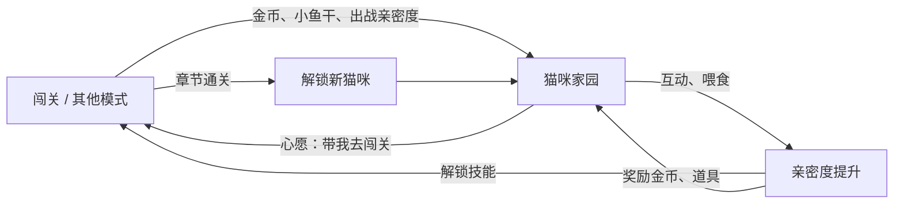

# 《喵喵大救援》游戏设计文档（GDD） v0.1

> 平台：抖音小游戏（竖屏、单手操作）  ·  品类：休闲闯关 + 猫咪养成  ·  文档状态：草案
>
> ⚙️ **本文档中所有数值均为 `[PLACEHOLDER]` 假设值**，需要经过试玩和数据回收后再调整。每个数值都写了设定理由，方便后续调参。

## 变更记录
| 版本 | 日期 | 内容 |
|---|---|---|
| v0.1 | 2026-11-14 | 根据原始大纲扩写：设计支柱、核心循环、主玩法、猫咪图鉴、亲密度、喂食、家园、经济、变现、新手引导、MVP 范围 |

---

## 0. 对原始大纲的主要优化建议（先看这里）

| # | 原方案 | 优化建议 | 理由 |
|---|---|---|---|
| 1 | 只写了"闯关"，没定具体玩法 | 主玩法定为 **竖屏三车道跑酷闯关**，每关终点**救出一只被困小猫** | 单指滑动、一局 60–90 秒，适合抖音碎片时间；"救猫"直接呼应项目名 saveCat，也把闯关和家园在剧情上连起来（救回来的猫住进院子） |
| 2 | 喂食用固定冷却时间 | 改为 **饱腹度** 机制：每次喂食增加饱腹度，饱腹度随时间下降，太饱就不吃 | 硬冷却只是个计时器，玩家只会觉得"被卡住"；饱腹度让玩家自己做选择（先喂便宜的小零食，还是留着肚子喂罐头），而且"吃不下啦～"的反馈更像真猫 |
| 3 | 每只猫只有一个独特技能 | 每只猫都有 **4 层技能**：主动技能 → 被动 → 主动强化 → 羁绊技，按亲密度逐层解锁 | 让亲密度有清楚的"变强"意义，玩家才会愿意长期养同一只猫 |
| 4 | 每局只能带一只猫 | **出战猫 + 助战猫**（助战猫只提供被动） | 把养多只猫变成有意义的搭配，助战猫也能拿到一半亲密度，减少"养了不用"的情况 |
| 5 | 家园只用来互动 | 家园加入 **每日心愿、离线产金币、家具布置、拍照分享、串门** | 每天上线有理由，有金币消耗途径，也能借助抖音的社交传播 |
| 6 | 亲密度会不会下降没写 | **亲密度永远不掉**，只会增加 | 治愈系游戏不要用惩罚来留人，靠"猫猫想你了"这类正向提醒召回玩家 |
| 7 | 猫咪怎么解锁 | 主线品种猫**通关章节必定获得**，不放进抽卡池；后续扩展猫用"猫铃铛碎片"兑换 | 体验有保证；另外抖音小游戏**没有版号就不能做内购**，开局应以广告变现为主，不适合依赖抽卡 |

---

## 1. 设计支柱（所有后续决策都以这 4 条为准）

1. **治愈陪伴**：猫咪本身就是奖励。每个系统都要让玩家觉得"我的猫很可爱、很像真猫"。
2. **碎片化爽快**：一局闯关 ≤ 90 秒，家园日常 ≤ 3 分钟，单手就能玩。
3. **每只猫都有用**：不同猫在不同关卡或模式下各有优势，没有完全淘汰的猫。
4. **温柔的长线目标**：只有正向积累，不惩罚离线；每天都有小目标，每周都有大目标。

**乐趣假设（最需要先验证的一点）**：*"在跑酷里释放猫咪技能、一路冲到终点救出小猫"这件事本身就好玩。* 如果灰盒原型阶段这一点不成立，后面的养成系统再多也救不回来。

---

## 2. 核心循环

| 层级 | 时长 | 玩家行为 | 反馈 / 奖励 |
|---|---|---|---|
| 瞬间层 | 0–30 秒 | 滑动躲障碍、捡小鱼干、充满能量后释放技能 | 撞碎、闪现等技能特效，猫叫音效，震动反馈 |
| 单局层 | 1–5 分钟 | 打完一关拿 1–3 星，救出小猫 | 金币、亲密度、救援动画 |
| 日常层 | 5–15 分钟/天 | 家园互动、完成心愿、喂食、领离线收益、每日挑战 | 亲密度、金币、签到奖励 |
| 长线层 | 数周 | 推章节、解锁新猫、亲密度满级、布置院子、冲排行榜 | 新猫、新技能、专属皮肤、好友排名 |

---

## 3. 世界观（一句话版）

> 小区里的流浪猫老大**大橘**发现，最近总有小猫被困在纸箱堆、下水道和吸尘器怪兽的地盘里。它决定一路闯过去把它们救回自家小院，组成一个温暖的猫咪大家庭。

- 每一关：救出一只**普通小奶猫**（只是剧情演出，不当作可养成角色，用来积累"已救援数"成就）
- 每章最后一关：救出一只**品种猫**，直接成为可养成角色，住进院子

---

## 4. 主玩法：救援闯关

### 4.1 机制说明
- **目的**：核心爽感来源，也是猫咪技能的主要展示场景
- **玩家体验**：轻松、爽快、"我的猫好厉害"
- **操作**：左右滑动换道，上滑跳跃，下滑趴下钻过去，点右下角按钮释放技能
- **关卡结构**：路线固定、手工设计，长度 60–90 秒，终点是被困小猫
- **生命值**：3 颗心，撞到障碍扣 1 颗，扣完就失败
- **技能能量**：捡小鱼干充能，充满后才能释放（每关大约能放 2–3 次）

| 星级 | 条件 |
|---|---|
| ★ | 通关 |
| ★★ | 收集的小鱼干 ≥ 关卡总数的 70% |
| ★★★ | 不扣血通关 |

**失败**：在死亡位置弹出"复活"选项（看激励视频广告或花猫薄荷，每局限 1 次），不复活就结算并获得基础亲密度 +5（失败也有收获，减少挫败感）。

**边界情况**
- 技能生效期间扣完血：无敌类技能期间不会扣血；其他技能照常扣血
- 能量满了还在捡小鱼干：多出来的转成金币（每条 = 1 金币），保证捡东西永远有意义
- 中途退出游戏：本关进度作废，**不消耗体力**（降低误触导致的流失）

### 4.2 障碍与关卡元素（按章节逐步加入）
| 元素 | 应对方式 | 首次出现 |
|---|---|---|
| 纸箱堆 | 换道 / 撞碎（橘猫） | 第 1 章 |
| 晾衣架 | 下滑钻过 | 第 1 章 |
| 水坑（猫怕水） | 跳过 | 第 1 章 |
| 巡逻的狗狗 | 躲开 / 用声波吓跑（暹罗） | 第 2 章 |
| 断桥 | 跳过 / 闪现过去（银渐层） | 第 3 章 |
| 吸尘器怪兽（追逐战） | 一直加速，不能停 | 每章最后一关 |

### 4.3 章节节奏
- 每章 10 关，第 10 关是追逐战并救出品种猫
- 体力：上限 30，每关消耗 5，每 6 分钟恢复 1 点 ⚙️
  - 理由：满体力 = 6 关 ≈ 8 分钟游戏时间，正好是一次碎片时间的量；回满约 3 小时，一天大概能回来 3–4 次
  - **第 1 章不消耗体力**，保证新手第一次进游戏能连续玩下去

---

## 5. 其他游戏模式

| 模式 | 解锁时机 | 玩法 | 作用 |
|---|---|---|---|
| **每日挑战** | 第 1 章通关 | 每天一个固定关卡，并指定一种"推荐猫"（用推荐猫奖励 ×1.5） | 轮流展示不同猫的用处，推动玩家培养多只猫 |
| **无尽夜巡** | 第 2 章通关 | 随机生成、越来越快的无尽跑酷；好友 / 全服周榜 | 社交比拼、长线目标，借助抖音好友关系链传播 |
| **猫咪运动会**（第二期） | 待定 | 用玩家的猫数据打异步对战竞速 | 中期留存 |
| **家园小游戏**（第二期） | 待定 | 逗猫棒节奏点击、躲猫猫 | 让家园玩法更丰富 |

所有模式都会给**出战猫**加亲密度（见第 7 节）。

---

## 6. 猫咪图鉴

### 6.1 技能结构（每只猫都按这个结构设计）
| 亲密度等级 | 解锁内容 |
|---|---|
| Lv1 | **主动技能**（获得猫咪时就有） |
| Lv3 | **被动技能**（当助战猫时也生效） |
| Lv5 | **主动技能强化**（持续时间或效果提升） |
| Lv7 | **羁绊技**（主动技能附加额外效果） |
| Lv10 | **专属皮肤 + 技能特效** + 家园特殊动作 |

### 6.2 首发 5 只猫
| 猫咪 | 定位 | 获得方式 | 主动技能（Lv1 → Lv5） | 被动技能（Lv3） | 羁绊技（Lv7） | 家园特性 |
|---|---|---|---|---|---|---|
| 🍊 **橘猫·大橘** | 冲撞 / 全能 | 开局就有 | **干饭冲锋**：3 秒无敌冲刺，撞碎路上的障碍并掉金币 → 4.5 秒 | **能吃是福**：捡到食物类道具时回复 1 颗心（每局最多 1 次） | **橘势不可挡**：冲锋结束时震碎全屏的小型障碍 | 吃东西获得的亲密度 +10%（橘猫爱吃） |
| 🎵 **暹罗·小暹** | 清障 / 控制 | 第 1 章通关 | **喵喵连环叫**：声波清除前方 3 格内所有可破坏障碍，吓退狗狗 → 范围 5 格 | **话痨**：技能能量获取 +15% | **回音**：1 秒后再放出一次声波 | 互动时会"回嘴"，有多段专属叫声 |
| ☁️ **布偶·布布** | 防御 / 新手友好 | 第 2 章通关 | **软绵守护**：获得能挡 2 次伤害的护盾 → 挡 3 次 | **慵懒体质**：每关第一次受伤免疫 | **仙女抱抱**：护盾碎掉时回复 1 颗心 | 抚摸会直接"瘫倒"，给的亲密度 ×1.2 |
| 🌙 **银渐层·银宝** | 技巧 / 竞速 | 第 3 章通关 | **月影瞬步**：向前闪现一段距离，路上的小鱼干自动收集 → 距离 ×1.5 | **轻盈**：跳得更高、滞空更久 | **残影**：闪现后 2 秒内无敌 | 夜晚待在院子里会发光（夜间限定动作） |
| 💰 **金渐层·金宝** | 资源 / 刷金币 | 7 日签到第 7 天（或第 4 章通关） | **招财猫爪**：10 秒内吸附金币和小鱼干，金币 ×2 → 15 秒 | **福气满满**：通关金币 +10% | **财源滚滚**：技能期间每秒额外掉落金币 | 家园离线产出 +20% |

**平衡说明**
- 金渐层是"刷资源型"，有可能成为唯一选择 → 解决办法：把每日挑战 / 无尽模式的推荐猫做成轮换；同时**关卡金币设每日上限**（见第 9 节），防止某一只猫刷到经济崩掉
- 银渐层门槛最高 → 在无尽模式里收益最大，给高手玩家一个追求目标
- 布偶给手残玩家兜底 → 第 2 章难度开始上升时正好拿到，时机刚好

### 6.3 出战猫 + 助战猫（第 2 章通关后解锁）
- 出战猫：提供主动技能和被动技能，拿 100% 出战亲密度
- 助战猫：只提供被动技能（需要 Lv3 以上），拿 50% 出战亲密度
- 搭配示例：布偶出战 + 暹罗助战（更快充满能量，护盾放得更勤），适合打难关

### 6.4 后续扩展猫（内容储备）
英短蓝猫、美短、狸花猫、黑猫（夜间关卡专精）、缅因猫（体型大，冲撞型）、无毛猫、三花猫（限定活动）……
- 获得方式：**猫铃铛碎片**（来源：每日挑战、无尽周榜、活动、成就），集满 60 片兑换一只 ⚙️

---

## 7. 亲密度系统

### 7.1 机制说明
- **目的**：长线成长的核心，把"闯关"和"家园"两部分连起来
- **玩家体验**："它越来越黏我了"，有陪伴感和投入感
- **规则**：每只猫单独计算，Lv1–Lv10，**永远不会下降**

### 7.2 升级所需亲密度 ⚙️
| 等级 | 1→2 | 2→3 | 3→4 | 4→5 | 5→6 | 6→7 | 7→8 | 8→9 | 9→10 | 累计 |
|---|---|---|---|---|---|---|---|---|---|---|
| 所需亲密度 | 100 | 200 | 350 | 550 | 800 | 1100 | 1500 | 2000 | 2600 | 9200 |

设计目标：普通玩家每天给一只猫攒约 150 点，大约 **2 个月**满级；投入很深的玩家每天约 600 点，大约 **2 周**满级。Lv3 在第 1–2 天就能达到，让玩家很快感受到第一次变强。

### 7.3 亲密度来源（单只猫、每天）⚙️
| 来源 | 单次 | 每日上限 | 说明 |
|---|---|---|---|
| 抚摸（点击） | +10 | 3 次 | 零成本，每天的基础互动 |
| 梳毛（拖动） | +15 | 1 次 | 拖动操作的小反馈，做完会掉"猫毛球"（可以收集，用来做毛毡家具） |
| 逗猫棒（10 秒小游戏） | +20 | 1 次 | 有一点操作趣味 |
| 完成心愿 | +30 | 1 次 | 见 8.3 |
| 出战通关 | +15（3 星再 +5） | 前 100 点全额，超过后减半 | 软上限，避免玩家只靠一只猫刷 |
| 出战失败 | +5 | 同上 | 失败也有收获 |
| 喂食 | 见第 8 节 | 受饱腹度限制 | 主要的付出型来源 |

### 7.4 亲密度等级奖励
除了第 6.1 节的技能，每升 1 级还会给：金币（等级 × 200）、猫零食包；Lv5 / Lv10 额外送猫铃铛碎片和家具。

---

## 8. 喂食与饱腹度（用来代替固定冷却）

### 8.1 机制说明
- **目的**：给亲密度加一个**节奏闸门**，同时消耗金币
- **玩家体验**："喂到它吃饱、满足地眯眼"，而不是"倒计时还剩 3 小时"
- **规则**
  - 每只猫的饱腹度为 0–100，每小时下降 10 ⚙️（大约 10 小时从全满降到空）
  - 饱腹度 **≥ 80** 时拒绝进食，猫会把头扭开："吃不下啦～"
  - 喂食 = 增加亲密度 + 增加饱腹度

| 食物 | 获取方式 | 亲密度 | 饱腹度 | 设计意图 |
|---|---|---|---|---|
| 猫粮 | 50 金币 | +20 | +20 | 日常消耗金币的主要途径 |
| 猫条 | 150 金币 / 每日任务 | +45 | +15 | **饱腹度低、性价比高**，"零食"定位，适合在快吃饱时补一口 |
| 猫罐头 | 猫薄荷、广告、等级奖励、活动（**不能用金币买**） | +100 | +40 | 稀有的大额补给 |

- 每天能喂进去的饱腹度约 240（随时间自然下降的部分 + 初始空间），所以喂食带来的亲密度每天大约在 240（全喂猫粮）到 550（混着喂罐头和猫条）之间
- **最爱食物**：每只猫有一种隐藏的最爱口味（例如大橘爱鸡肉罐头），喂到最爱时亲密度 ×1.5，并播放专属开心动画。第一次喂到之后会记录在图鉴里，这是一个让玩家自己去发现的设计点
- **边界情况**
  - 修改手机时间作弊：饱腹度按**服务端时间**计算
  - 离线 3 天：饱腹度降到 0 就停止，不会出现"饿坏"之类的负面状态
  - 激励广告"加个餐"：每只猫每天 1 次，看完立刻减少 30 饱腹度（这是给愿意看广告的玩家的轻度加速，不是硬性门槛）

---

## 9. 猫咪家园

### 9.1 场景
- 一个可以缩放、横向拖动的 2.5D 小院子：草地、阳光区、树荫、屋檐、小池塘
- 已拥有的猫在院子里自由活动，状态机包括：闲逛、睡觉、晒太阳、舔毛、追蝴蝶、两只猫一起玩（多猫互动是很重要的萌点）
- **昼夜同步现实时间**：晚上猫咪会聚到灯下或窝里，银渐层发光

### 9.2 互动
- 点击猫咪：抚摸（不同部位反应不同，比如摸肚子可能会被"哈气"，但不扣任何东西）
- 长按猫咪：抱起来，可以拖到另一个位置放下
- 互动面板：梳毛 / 逗猫棒 / 喂食 / 查看图鉴

### 9.3 每日心愿（每天的小钩子）
每只猫每天头顶冒出一个心愿气泡，完成后亲密度 +30、送金币：
- "想吃猫条" → 喂食
- "想晒太阳" → 把猫窝摆到阳光区
- "想出去玩" → 带它闯关 1 次（**把玩家从家园引回闯关**）
- "想要新玩具" → 购买或放置某件家具

### 9.4 离线产出
- 每只猫每小时产出金币 = 5 × 亲密度等级 ⚙️，院子里所有猫的产出合计
- 最多存 8 小时（理由：大约就是一次睡眠或上班的时长，鼓励一天回来 2–3 次）
- 金币会变成院子里的小金币气泡，需要点击收集（收集本身就是一个小反馈）
- 看激励广告可以把本次收益翻倍（每天 3 次）

### 9.5 家具与舒适度
- 家具种类：猫爬架、纸箱、猫窝、猫抓板、鱼缸、花盆……用金币或猫毛球（梳毛产出）购买
- **舒适度**：家具总分可以提高离线收益上限（8 小时 → 最多 12 小时），并解锁新的猫咪动作（猫爬架 → 猫会爬上去睡）
- 这是金币的主要**长期消耗途径**，防止后期金币越积越多

### 9.6 社交（借助抖音平台能力）
- **拍照模式**：加滤镜、贴纸、相框，一键分享到抖音（拉新的主要途径）
- **串门**：去好友的院子撸猫，双方都拿少量金币（每天 5 次）
- 留言板：在好友院子里留下小鱼干或爪印

---

## 10. 经济系统

### 10.1 货币
| 货币 | 类型 | 主要来源 | 主要消耗 |
|---|---|---|---|
| 金币 | 普通货币 | 闯关、离线产出、任务、串门、亲密度升级 | 猫粮、猫条、家具 |
| 猫薄荷 | 稀有货币 | 成就、首次三星通关、周榜、签到、激励广告、（有版号后）内购 | 复活、罐头、限定家具、皮肤 |
| 猫铃铛碎片 | 兑换材料 | 每日挑战、周榜、活动 | 兑换扩展猫 |
| 猫毛球 | 家园材料 | 梳毛 | 毛毡类家具 |
| 体力 | 闯关门票 | 自动恢复、广告、侧边栏奖励 | 闯关 |

### 10.2 金币收支模型（普通玩家，每天）⚙️
| 来源 | 数量 |
|---|---|
| 闯关（12 关 × 40） | ~480（每日上限 1200，防止金渐层刷爆） |
| 离线产出（3 只猫平均 Lv3，两次 × 8 小时） | ~720 |
| 每日任务 | 300 |
| **合计** | **~1500** |

| 消耗 | 数量 |
|---|---|
| 喂食（3 只猫 × 4 次猫粮） | 600 |
| 家具（存钱，平均每 2–3 天买一件 ~1500–3000 的家具） | ~700 |
| **合计** | **~1300** |

- **健康标准**：每日人均金币净增长保持在 0–20% 之间。如果连续 7 天超过 30%，就说明在通胀，需要加新的家具或消耗点

---

## 11. 变现与抖音平台适配

> ⚠️ 需要核实：抖音小游戏**没有版号时只能用广告变现**，内购需要版号。建议首发以广告变现为主，内购相关功能先预留接口。

### 11.1 激励视频点位（全部由玩家主动选择，不强制弹出）
| 点位 | 每日上限 | 奖励 |
|---|---|---|
| 失败复活 | 每局 1 次 | 原地复活并恢复 1 颗心 |
| 结算双倍 | 5 次 | 金币 ×2 |
| 离线收益翻倍 | 3 次 | 收益 ×2 |
| 体力补给 | 3 次 | +10 体力 |
| 给猫加个餐 | 每只猫 1 次 | 饱腹度 −30 |
| 每日罐头 | 1 次 | 猫罐头 ×1 |

### 11.2 平台能力清单
- **侧边栏复访奖励**（抖音的规范要求）：从侧边栏进入游戏每天领一次体力 + 猫条
- 添加到桌面奖励：一次性送 50 猫薄荷
- 分享：拍照分享、通关战报分享
- 好友排行榜（开放数据域）：无尽夜巡
- 游戏录屏：救出品种猫的动画、追逐战高光时刻，自动录屏后可以发布

### 11.3 有版号之后的内购（预留）
月卡（每天领猫薄荷 + 离线上限 +4 小时）、猫咪专属皮肤、限定家具套装。**不卖亲密度等级，不卖技能**，保护公平性和陪伴感。

---

## 12. 新手引导（前 5 分钟）

| 时间 | 节点 | 目标 |
|---|---|---|
| 0:00 | 开场 15 秒动画：大橘听到小猫的求救声 | 交代动机，可以跳过 |
| 0:15 | 第 1-1 关：只教左右滑动，**不可能失败**（没有扣血的障碍） | 第一次就成功 |
| 1:30 | 1-2：教跳跃和下滑；1-3：教捡小鱼干 → 释放干饭冲锋 | 核心操作 + 技能爽感 |
| 3:00 | 救出第一只小奶猫 → **自动进入家园** | 第一次看到院子 |
| 3:30 | 引导抚摸大橘 → 喂一次猫粮 → 亲密度条上涨 | 理解养成 |
| 4:30 | 展示第 1 章终点的暹罗剪影："它还在等你……" | 留下悬念，"再来一关" |
| ~15:00 | 第 1 章通关，获得暹罗，**第一次感受到猫咪种类和技能的差异** | 第一天的留存高光 |

### 前 7 天的留存钩子
| 天数 | 钩子 |
|---|---|
| D1 | 获得暹罗、大橘升到 Lv3 拿到第一个被动 |
| D2 | 解锁每日挑战、第一次收离线金币 |
| D3–4 | 接近第 2 章通关 → 获得布偶；解锁出战 + 助战 |
| D5 | 解锁无尽夜巡和好友排行 |
| D7 | 签到获得金渐层（明确的 7 日目标，从第 1 天开始就在签到面板展示） |

---

## 13. 成功 / 失败判定标准（试玩前先定义好）

| 指标 | 目标 | 未达标时的处理方向 |
|---|---|---|
| 新手引导完成率 | > 90% | 精简文字，删掉多余步骤 |
| 1-1 到 1-10 的关卡流失 | 单关流失率 < 5% | 找出流失最高的关卡并降低难度 |
| 次日留存 | ≥ 40% | 加强 D1 的奖励和悬念 |
| 每天进入家园的次数 | ≥ 2 次 | 加强心愿和离线收益的吸引力 |
| 猫咪出战分布 | 没有任何一只猫 > 50% | 调整强度或推荐猫的轮换 |
| 每日人均金币净增长 | 0–20% | 见 10.2 |

---

## 14. 开发范围与路线图

### MVP（第一个可试玩版本，验证乐趣假设）
- 跑酷核心玩法 + 第 1–2 章（20 关）
- 橘猫、暹罗、布偶 3 只猫，亲密度做到 Lv5
- 家园：自由活动、抚摸 / 喂食 / 饱腹度、离线金币
- 激励广告的复活和双倍点位

### V1.0（正式上线）
- 第 3–4 章，银渐层、金渐层，亲密度做到 Lv10
- 每日挑战、无尽夜巡 + 好友排行
- 心愿、家具、舒适度、拍照分享、侧边栏奖励、7 日签到

### V1.x
- 串门、扩展猫与猫铃铛碎片、节日限定猫、猫咪运动会、家园小游戏

---

## 15. 待确认问题
1. 主玩法是否确定用**三车道跑酷**？（备选方案：横版平台跳跃、消除 + 技能、物理解谜救猫。跑酷对单手和短时长最友好，开发量也比较可控）
2. 美术风格：2D 手绘 Q 版，还是 3D 低多边形？（影响家园是做 2.5D 还是真 3D）
3. 首发有没有版号？（决定要不要做内购）
4. 要不要接入后端服务器？（饱腹度防作弊、排行榜、串门都需要服务端；纯单机的话这几项要简化）
5. 使用什么引擎？（Cocos Creator 对抖音小游戏的支持最成熟，Unity 小游戏方案也可行）
