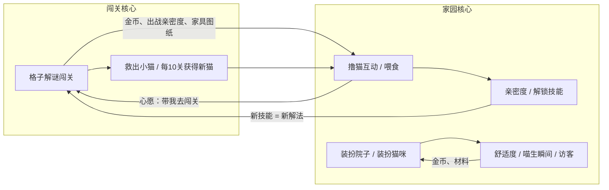

# 《喵喵救援队》游戏设计文档（GDD） v0.2

> 平台：抖音小游戏（竖屏、单手操作）  ·  品类：**回合制格子解谜 + 猫咪家园养成（双核心）**  ·  文档状态：草案
>
> ⚙️ 所有数值都是 `[PLACEHOLDER]` 假设值，需要试玩验证。每个数值都写了设定理由。
>
> 🐱 猫咪形象与图鉴 Demo：`demo/index.html`（直接用浏览器打开）

## 变更记录
| 版本 | 日期 | 内容 |
|---|---|---|
| v0.1 | 2026-11-14 | 初稿：跑酷闯关 + 家园 |
| v0.2 | 2026-11-14 | ① 主玩法从跑酷改为 **「一猫一动词」回合制格子解谜**，让每只猫的特点都变成解题手段；② 家园升级为**和闯关并列的双核心**，新增家园装扮、猫咪装扮、喵生瞬间、访客、扩建；③ 确定第一期 9 只猫及各自的获取方式、外形、技能、图鉴介绍；④ 去掉体力系统，更适合佛系玩家 |

---

## 0. 本版改动摘要

| # | 你提的问题 / 要求 | v0.2 的方案 |
|---|---|---|
| 1 | 跑酷里猫咪技能只是数值差异，体现不出特点 | 改成**回合制格子解谜**。每只猫的技能就是它**真实性格对应的一个专属动作**：大橘"推"、金舔舔"舔"、银小妹"跳"、小布丁"躺"、小罗"叫"、汤姆"拍"、菲菲"盯"、阿狸"爬"、悟空"听"。关卡里的机关和这些动作一一对应，**换一只猫，解题思路就完全不同** |
| 2 | 家园是和闯关同样重要的核心，要贴合佛系玩家 | 家园不只是附属功能：只玩家园也能把亲密度养满、攒金币买猫、收集装扮和相册。新增**院子装扮、猫咪装扮、喵生瞬间相册、访客送礼、院子扩建** |
| 3 | 9 只猫和它们的获取途径 | 初始 1 只 + 主线每 10 关 1 只（共 4 只）+ 签到 2 只 + 金币商店 1 只 + 广告累计 1 只，见第 4 节 |
| 4 | 每只猫要有特色外形和图鉴介绍 | 第 4.3 节有完整图鉴，Demo 里能直接看到形象和待机动作 |
| 5 | 佛系体验 | **去掉体力**、**解谜没有时间限制**、可以无限撤销、不会"死亡"；广告改为提示、双倍奖励这类可选点位 |

---

## 1. 设计支柱

1. **每只猫都是独一无二的**：外形、性格、技能、家园行为四个方面保持一致。玩家记住的应该是"金舔舔爱舔"，而不是"金渐层攻击 +10%"。
2. **双核心，按自己的节奏玩**：喜欢动脑的玩家去闯关，佛系玩家在家园撸猫和装扮，两条路都能成长，**没有哪条是必须走的**。
3. **治愈、没有压力**：没有体力、没有倒计时、没有失败惩罚，亲密度永远不会下降。
4. **碎片时间友好**：一关 1–3 分钟，家园日常 3–5 分钟。

**乐趣假设**：*"这关要用谁？——哦！让小布丁躺在压力板上，银小妹就能跳过去！"* 这种用猫咪特点解开谜题的"啊哈时刻"本身就好玩。灰盒原型要先验证这一点。

---

## 2. 核心循环（双核心）



| 层级 | 闯关路线 | 家园路线 |
|---|---|---|
| 瞬间（秒级） | 点格子移动、释放技能，机关立刻有反馈 | 摸猫有呼噜声和爱心，猫咪做出可爱反应 |
| 单次（分钟级） | 解开一关，拿 1–3 星 | 完成心愿、喂食、收金币、摆一件家具 |
| 日常（天） | 每日一谜、推几关主线 | 签到、心愿、离线收益、访客礼物 |
| 长线（周） | 推章节、获得新猫、集齐三星 | 亲密度满级、套装收集、相册收集、院子扩建 |

---

## 3. 主玩法：「一猫一动词」格子解谜

### 3.1 机制说明
- **目的**：让每只猫的特点都变成解题手段
- **玩家体验**：动脑想出办法的成就感，以及"这只猫好有它自己的样子"的认同感
- **场景**：俯视角 2.5D 的房间、院子、小区等，地图 6×8 到 8×10 格
- **目标**：让任意一只猫走到**被困小猫**所在的格子
- **出战位**：每关指定 1–3 个出战位，玩家从已有的猫里选；关卡会显示"推荐动词"图标作为提示
- **操作**
  - 点击格子：当前选中的猫自动寻路走过去，每走 1 格算 1 步
  - 点击头像：切换当前操作的猫
  - 点击技能按钮，再点目标格子：释放技能，算 1 步
  - 撤销：无限次，免费；重来：免费
- **敌人**（狗狗、扫地机器人、小孩）：每走一步，它们按固定路线移动一次；猫走进敌人的视野会被"发现"，自动撤回一步（不会失败，只是一个温和的阻碍）

| 星级 | 条件 |
|---|---|
| ★ | 救出小猫 |
| ★★ | 收集关卡里全部 3 条小鱼干 |
| ★★★ | 步数 ≤ 目标步数 |

**设计原则**
- **主线关卡只依赖主线能拿到的猫**（大橘、银小妹、小布丁、小罗、悟空），保证不花钱、不看广告、不签到也能通关
- **其他猫提供"妙解"**：比如用汤姆把架子上的花盆拍下来当桥，可以比标准解法少走 4 步，更容易拿三星。这样非主线猫有实际价值，但不是必需
- **猫咪专属关**：每获得一只猫，就开放 5 关只能用它的专属关，用来教会玩家它的动作

### 3.2 动词与机关对照表
| 猫咪 | 动词 | 对应的机关 / 障碍 | 首次出现 |
|---|---|---|---|
| 大橘 | **推** | 纸箱、花盆、洗衣篮（重物） | 第 1 章 |
| 银小妹 | **跳** | 1 格缝隙、矮墙、桌子 / 柜子（高台） | 第 2 章 |
| 小布丁 | **躺** | 压力板、按钮门、自动门 | 第 3 章 |
| 小罗 | **叫** | 巡逻狗狗、扫地机器人（引开） | 第 4 章 |
| 悟空 | **听** | 隐藏暗道、墙里的机关、老鼠洞 | 第 5 章 |
| 金舔舔 | **舔** | 冰块、糖浆地面、哭闹的人类小孩 | 妙解 / 专属关 |
| 汤姆 | **拍** | 高处的杯子、花瓶、书（拍落后可以砸开关、搭桥、挡路） | 妙解 / 专属关 |
| 菲菲 | **盯** | 所有巡逻敌人（定身） | 妙解 / 专属关 |
| 阿狸 | **爬** | 围墙、篱笆、树 | 妙解 / 专属关 |

### 3.3 关卡示例（第 3 章第 5 关「洗衣房」）
```
出战位：2   目标步数：14
[小猫] 在一扇按钮门后面；门前有一块压力板；路上有一条缝隙
标准解：小布丁走到压力板上 → 布偶瘫（门打开）→ 切换银小妹 → 跳过缝隙 → 穿过门（16 步）
妙解：  金舔舔舔化冰块，走侧边的近路（12 步，三星）
```

### 3.4 章节结构
| 章节 | 关卡 | 场景 | 新动词 | 通关奖励 |
|---|---|---|---|---|
| 1 | 1–10 | 小区花坛 | 推 | 第 10 关：**银小妹** |
| 2 | 11–20 | 楼道与天台 | 跳 | 第 20 关：**小布丁** |
| 3 | 21–30 | 洗衣房 | 躺 | 第 30 关：**小罗** |
| 4 | 31–40 | 宠物医院 | 叫 | 第 40 关：**悟空** |
| 5+ | 41– | 老街、菜市场…… | 听、组合关 | 后续版本的新猫 |

每章第 10 关是"大救援"关：地图更大，需要组合多个动词，救出的品种猫直接成为可养成角色。

### 3.5 其他模式
| 模式 | 解锁条件 | 说明 |
|---|---|---|
| 每日一谜 | 第 1 章通关 | 每天一题，指定"今日主角猫"；好友之间比步数排行 |
| 猫咪专属关 | 获得对应猫咪 | 每只猫 5 关，三星奖励这只猫的专属装扮 |
| 周末大救援（第二期） | 待定 | 大地图、可以多人协作的异步关卡 |

---

## 4. 猫咪图鉴（第一期 9 只）

### 4.1 获取方式
| 猫咪 | 品种 | 获取方式 | 理由 |
|---|---|---|---|
| 大橘 | 橘猫 | 初始拥有 | 救援队队长，教会"推" |
| 银小妹 | 银渐层 | 主线第 10 关 | 第一个新动词"跳"，前 15 分钟内就能拿到 |
| 小布丁 | 布偶猫 | 主线第 20 关 | |
| 小罗 | 暹罗猫 | 主线第 30 关 | |
| 悟空 | 简州猫 | 主线第 40 关 | 第一期的压轴猫，国潮本土特色 |
| 金舔舔 | 金渐层 | **累计**签到第 3 天 | 第 3 天的留存钩子；累计计算，断签也不会错过 |
| 菲菲 | 三花猫 | **累计**签到第 7 天 | 第 7 天的留存钩子 |
| 阿狸 | 狸花猫 | 金币商店 8000 金币 ⚙️ | 佛系玩家只玩家园大约 6–8 天能攒够，是一个"攒钱买它"的长期目标 |
| 汤姆 | 蓝白猫 | 累计看激励广告 30 次 ⚙️ | 每天上限 10 次，最快 3 天、正常 1–2 周；界面上显示进度条 |

> 主线以外的 4 只猫（金舔舔、菲菲、阿狸、汤姆）的动词都**不是主线通关必需**，只用来提供"妙解"和专属关，保证公平。

### 4.2 技能结构（所有猫统一）
| 亲密度 | 解锁 |
|---|---|
| Lv1 | **主技能**（专属动词） |
| Lv3 | **被动** |
| Lv5 | **主技能强化** |
| Lv7 | **羁绊技** |
| Lv10 | **专属皮肤** + 家园特殊动作 |

### 4.3 图鉴明细

> 💡 以下内容和 Demo 里的数据（`demo/js/cats.js`）完全一致，以 Demo 为准。

#### 🍊 大橘 · 橘猫 · ♂ — 动词「推」
- **获取**：初始拥有  ·  **性格**：贪吃 / 憨厚 / 讲义气
- **外形**：圆滚滚的橘色大胖猫，额头有"王"字虎纹，白下巴、白肚皮，尾巴上一圈圈环纹，脖子挂着小鱼骨铃铛
- **图鉴介绍**：小区流浪猫的前任老大，饭量能顶三只猫，力气也大得惊人，一屁股能把纸箱坐扁。被你收养那天，它把珍藏的最后一条小鱼干推到你脚边——从此它就是你的第一个家人，也是喵喵救援队的队长。
- **技能**：主「干饭推土机」推动相邻的重物 1 格 → Lv3「能吃是福」每关第一次吃到小鱼干时返还 1 步 → Lv5 可以一次推动连在一起的 2 个重物 → Lv7「泰山压顶」跳起一屁股坐碎前方的木箱 → Lv10 皮肤「大橘为重」
- **家园特性**：永远守在饭盆边，喂食获得的亲密度 +10%  ·  **最爱**：鸡肉罐头

#### 👅 金舔舔 · 金渐层 · ♂ — 动词「舔」
- **获取**：累计签到第 3 天  ·  **性格**：爱舔 / 热情 / 黏人
- **外形**：奶油金色的毛，背部和尾巴有金棕色渐层，碧绿色大眼睛，粉色小舌头永远收不回去，胸前有一撮蓬松的白毛
- **图鉴介绍**：从小就喜欢到处舔：舔别的小猫、舔玩具、舔人类的脸，连镜子里的自己都不放过。在金舔舔的世界里，没有什么问题是舔一舔解决不了的——如果有，那就多舔几下。
- **技能**：主「舔舔大法」舔化相邻的冰块和糖浆，或者舔一舔安抚哭闹的小孩让他让路 → Lv3「舔毛治愈」队友被发现时，免除一次撤回 → Lv5 一次舔掉连着的 2 格 → Lv7「舔舔传染」被它舔过的队友，下一次技能不消耗步数 → Lv10 皮肤「蜂蜜王子」
- **家园特性**：会主动去舔其他猫，被舔过的猫当天互动亲密度 +5  ·  **最爱**：三文鱼猫条

#### 🎀 银小妹 · 银渐层 · ♀ — 动词「跳」
- **获取**：主线第 10 关  ·  **性格**：优雅 / 轻盈 / 小公主
- **外形**：银白色的毛，背部和尾尖带银灰色渐层，翠绿色眼睛，身材娇小纤细，左耳戴着粉色蝴蝶结
- **图鉴介绍**：院子里最轻盈的小姑娘，走路像踮着脚尖跳芭蕾，能轻松跳上一人高的柜子，从不碰倒任何东西。被大橘从高高的空调外机上救下来以后，银小妹就决定：以后换我来带大家跳过所有难关。
- **技能**：主「芭蕾跳跃」跳过 1 格缝隙或矮障碍，或者跳上高台 → Lv3「猫步」在高台上移动不会被发现 → Lv5 跳跃距离 2 格 → Lv7「天鹅湖」落地时震落附近高处的小鱼干 → Lv10 皮肤「月光芭蕾」
- **家园特性**：喜欢待在院子里最高的家具上  ·  **最爱**：鳕鱼冻干

#### ☁️ 小布丁 · 布偶猫 · ♀ — 动词「躺」
- **获取**：主线第 20 关  ·  **性格**：温柔 / 软萌 / 嗜睡
- **外形**：长长的奶白色蓬松毛，脸、耳朵和尾巴是海豹褐重点色，戴着四只白手套，宝石蓝大眼睛，脖子一圈蓬松的围脖毛
- **图鉴介绍**：一抱起来就全身瘫软，像只真正的布娃娃。小布丁能在任何地方睡着——压力板上、按钮上、别的猫身上。大家起初以为它只会睡觉，后来才发现：它睡在哪里，哪里的门就会打开。
- **技能**：主「布偶瘫」原地瘫倒，压住压力板或按钮，在它起身前机关一直保持开启 → Lv3「棉花糖垫子」队友可以踩着它跳上高台 → Lv5 瘫倒时能压住相邻 2 格 → Lv7「呼噜催眠」瘫倒时让附近的狗狗也睡着 → Lv10 皮肤「云朵布丁」
- **家园特性**：一摸就翻肚皮，抚摸获得的亲密度 ×1.2  ·  **最爱**：羊奶布丁

#### 📢 小罗 · 暹罗猫 · ♂ — 动词「叫」
- **获取**：主线第 30 关  ·  **性格**：话痨 / 大嗓门 / 社牛
- **外形**：奶油色的身体，脸、耳朵、四爪和尾巴是深咖啡色重点色（俗称"挖煤脸"），冰蓝色眼睛，身材修长，脖子挂着一个小喇叭吊坠
- **图鉴介绍**：院子里的"大喇叭"，一天到晚喵个不停，从早饭聊到晚饭。小罗的嗓门大到能把三条街外的狗狗喊过来——这原本是个缺点，直到大家发现，可以用它把看门的狗狗引开。
- **技能**：主「喵喵大喇叭」大叫一声，3 格内的巡逻敌人会朝小罗走过来（引开敌人） → Lv3「话痨」每关可以免费获得一次提示 → Lv5 范围扩大到 5 格 → Lv7「狮吼功」叫声能震开半掩的门、吓跑老鼠 → Lv10 皮肤「摇滚歌手」
- **家园特性**：你一进家园它就跑来迎接，每天第一次进家园额外送金币  ·  **最爱**：金枪鱼猫条

#### 😼 汤姆 · 蓝白猫 · ♂ — 动词「拍」
- **获取**：累计看激励广告 30 次  ·  **性格**：捣蛋 / 机灵 / 拆家大王
- **外形**：上半身蓝灰色，嘴巴、胸口和四爪雪白（像穿着白衬衫、白袜子），圆脸，铜色圆眼睛，嘴角总挂着坏笑
- **图鉴介绍**：桌上的杯子？拍下去。架子上的花瓶？拍下去。你的手机？……先看看你的表情，再拍下去。汤姆是院子里的头号拆家大王，但在救援任务里，它总能把东西精准地"拍"到最需要的位置。
- **技能**：主「推杯换盏」把相邻高处的物品拍落到指定方向（可以砸开关、搭桥、挡住敌人） → Lv3「眼疾手快」每关有 1 次拍东西不消耗步数 → Lv5 能拍落 2 格远的物品 → Lv7「连环拍」被拍落的物品会一直滚，直到撞上障碍 → Lv10 皮肤「绅士汤姆」
- **家园特性**：偶尔把家具上的小摆件拍到地上，捡起来能得到金币  ·  **最爱**：牛肉冻干

#### 👑 菲菲 · 三花猫 · ♀ — 动词「盯」
- **获取**：累计签到第 7 天  ·  **性格**：傲娇 / 聪明 / 招福
- **外形**：白底毛色，头顶和背上有橘色、黑色两色花斑，一侧眼睛被黑斑包着，琥珀色眼睛，头戴小金冠，尾巴总是高高翘起
- **图鉴介绍**：三花猫几乎都是小母猫，传说还能招来好运。菲菲是院子里的小女王，平时爱答不理，但只要她用那双眼睛"盯——"住谁，谁就一动也不敢动。据说巡逻的狗狗见到她都要绕道走。
- **技能**：主「女王凝视」盯住一个巡逻敌人，让它 3 回合不能动 → Lv3「招福」关卡结算金币 +10% → Lv5 定身延长到 5 回合 → Lv7「傲娇一瞥」同时盯住一条直线上的所有敌人 → Lv10 皮肤「招福女王」
- **家园特性**：傲娇，每天能抚摸的次数少 1 次，但每次获得的亲密度翻倍  ·  **最爱**：高级三文鱼罐头

#### 🌿 阿狸 · 狸花猫 · ♂ — 动词「爬」
- **获取**：金币商店  ·  **性格**：勇敢 / 野性 / 运动健将
- **外形**：棕灰色的毛，全身黑色鱼骨状条纹，额头有清晰的"M"字纹，黄绿色眼睛，身材结实，戴着一条绿色小头巾
- **图鉴介绍**：中华田园猫里的"特种兵"，身手矫健，能飞檐走壁。阿狸在街头长大，什么样的围墙、树干、篱笆都拦不住它。它不太爱撒娇，却总在你不注意的时候，悄悄把一件"战利品"放在你门口。
- **技能**：主「飞檐走壁」爬上相邻的围墙、篱笆或树，翻到另一边 → Lv3「街头经验」敌人对它的视野范围 −1 格 → Lv5 可以在墙顶上走 2 格 → Lv7「猛虎扑」从高处扑下，赶跑一只巡逻敌人 → Lv10 皮肤「侠客阿狸」
- **家园特性**：每天夜里带回一件"战利品"（随机道具或家具材料）  ·  **最爱**：鸡胸肉干

#### 🐒 悟空 · 简州猫 · ♂ — 动词「听」
- **获取**：主线第 40 关  ·  **性格**：机灵 / 捕鼠王 / 顺风耳
- **外形**：金黄色短毛带浅色虎斑，一对大耳朵，每只耳朵里还多长了一片小耳廓（"四耳猫"），金色眼睛，额头戴着一圈金箍
- **图鉴介绍**：来自四川简阳的本土名猫，耳廓里多长了一层小耳朵，人称"四耳猫"，也是远近闻名的捕鼠高手。悟空天生一副顺风耳，墙里的老鼠、地下的暗道，都逃不过它的耳朵。它最大的梦想，是拥有一根自己的金箍棒——目前暂时用逗猫棒代替。
- **技能**：主「顺风耳」听出 5 格内隐藏的暗道、机关和老鼠洞，并把它们显示出来 → Lv3「捕鼠王」老鼠见到它会逃跑，并留下小鱼干 → Lv5 范围扩大到全图 → Lv7「筋斗翻」翻个跟头越过 2 格，无视地形 → Lv10 皮肤「齐天大圣」
- **家园特性**：有它在院子里巡逻，访客带来的礼物品质会提升  ·  **最爱**：清水煮羊肉

> ⚠️ 简州猫的"四耳"特征和产地信息，美术定稿前请再查证一次资料。

---

## 5. 亲密度系统（沿用 v0.1，小幅调整）
- 每只猫单独计算，Lv1–Lv10，**永远不会下降**
- 升级所需亲密度：100 / 200 / 350 / 550 / 800 / 1100 / 1500 / 2000 / 2600（累计 9200）⚙️
- 来源（单只猫、每天）

| 来源 | 单次 | 每日上限 |
|---|---|---|
| 抚摸 | +10 | 3 次（菲菲 2 次，每次翻倍） |
| 梳毛 | +15 | 1 次 |
| 逗猫棒小游戏 | +20 | 1 次 |
| 完成心愿 | +30 | 1 次 |
| 出战通关（三星再 +5） | +15 | 前 100 点全额，超过后减半 |
| 当作"妙解"主角通关 | 额外 +10 | — |
| 喂食 | 见第 6 节 | 受饱腹度限制 |

- 每升 1 级奖励：金币（等级 × 200）、零食包；Lv5 / Lv10 额外送专属装扮

## 6. 喂食与饱腹度（沿用 v0.1）
- 饱腹度 0–100，每小时下降 10；**饱腹度 ≥ 80 时拒绝进食**（"吃不下啦～"）
- 猫粮（50 金币）：亲密度 +20 / 饱腹度 +20；猫条（150 金币）：+45 / +15；猫罐头（不能用金币买）：+100 / +40
- 喂到**最爱食物**亲密度 ×1.5，第一次喂到会记录进图鉴
- 饱腹度按服务端时间计算；饿了不会有任何惩罚

---

## 7. 猫咪家园（双核心之一）

### 7.1 设计目标
佛系玩家**只玩家园**也能获得完整的养成体验：亲密度满级、攒钱买猫（阿狸）、收集装扮和相册。家园的节奏是"每天来看看猫、摆摆东西、拍拍照"，不需要动脑、也不需要操作技巧。

### 7.2 院子与扩建
| 区域 | 解锁条件 | 特点 |
|---|---|---|
| 前院（初始） | — | 草地、饭盆、小纸箱 |
| 花园 | 家园等级 3 | 花丛、池塘，猫会追蝴蝶 |
| 客厅 | 家园等级 6 | 室内家具，下雨天猫咪会进屋 |
| 天台 | 家园等级 10 | 看星星，晚上有专属喵生瞬间 |

**家园等级**由**舒适度**累计提升；舒适度来自摆放的家具。

### 7.3 家园装扮
- **家具**：功能型（猫爬架、猫窝、猫抓板、饭盆、玩具），会改变猫的行为；装饰型（花盆、灯、围栏、地毯），提升舒适度
- **主题套装**：比如「日式庭院」「田园菜地」「糖果乐园」「国潮四合院」，集齐一套后解锁套装专属的猫咪动作和全家福相框
- **地面、围墙、小屋外观**：可以整体更换院子的风格
- **季节和节日主题**：春节、中秋、万圣节等限时家具
- **获取途径**：金币商店、家具图纸（闯关三星掉落）+ 材料（猫毛球、阿狸的战利品）合成、活动、广告每日免费刷新

### 7.4 猫咪装扮
- 每只猫有帽子、项圈、衣服、眼镜 4 个装扮位
- 通用装扮（所有猫都能穿）+ 专属装扮（猫咪专属关、亲密度 Lv5 奖励）+ Lv10 专属皮肤
- 猫咪的默认配饰（大橘的鱼骨铃铛、银小妹的蝴蝶结、悟空的金箍等）是它的标志，**换装时可以选择保留**

### 7.5 猫咪自主生活（每只猫的家园行为都和性格一致）
| 猫咪 | 家园里的专属行为 |
|---|---|
| 大橘 | 守着饭盆、偷吃别的猫的饭 |
| 金舔舔 | 追着别的猫舔 |
| 银小妹 | 跳上最高的家具 |
| 小布丁 | 随时随地瘫倒睡觉 |
| 小罗 | 冲着你、冲着别的猫喵个不停 |
| 汤姆 | 把桌上的摆件拍到地上 |
| 菲菲 | 坐在高处俯视众猫，尾巴高翘 |
| 阿狸 | 在围墙上巡逻，叼回战利品 |
| 悟空 | 竖起耳朵听动静、翻跟头 |

- **猫咪关系**：特定的猫咪组合会成为"好朋友"，比如大橘和小布丁一起晒太阳、金舔舔追着菲菲舔然后被嫌弃，触发专属的喵生瞬间

### 7.6 喵生瞬间（相册收集）
- 猫咪和家具、猫咪和猫咪之间会随机发生可爱事件，玩家可以点击"拍下"存进相册
- 每只猫有 10 个专属瞬间，另外还有组合瞬间和套装瞬间
- 收集进度奖励装扮和猫罐头；照片可以一键分享到抖音（主要的拉新途径）

### 7.7 访客
- 流浪猫、小鸟、刺猬等访客会被特定家具吸引过来，离开时留下礼物（金币、材料、稀有家具图纸）
- 访客图鉴也是一条佛系的收集线

### 7.8 日常
心愿（每只猫每天 1 个）、离线金币产出（每只猫每小时 5 × 亲密度等级，最多存 8 小时，舒适度可以延长到 12 小时）、收访客礼物、喂食。

### 7.9 社交
拍照分享、去好友院子串门（帮好友撸猫，双方都拿到少量金币）、留言板。

---

## 8. 经济系统

| 货币 | 来源 | 消耗 |
|---|---|---|
| 金币 | 闯关、离线产出、任务、访客、亲密度升级 | 猫粮、猫条、家具、**阿狸（8000）** |
| 猫薄荷（稀有） | 成就、三星、签到、广告、（有版号后）内购 | 猫罐头、限定家具、皮肤 |
| 猫毛球 | 梳毛 | 毛毡类家具 |
| 家具图纸 | 闯关三星、访客 | 合成家具 |

- 去掉体力：解谜游戏本身就会让人"卡关"，再加体力只会劝退佛系玩家
- 只玩家园的玩家，每天约 800–1000 金币；同时闯关和玩家园的玩家，约 1500 金币。阿狸定价 8000，两类玩家分别大约 8 天、5 天能买到 ⚙️
- 健康标准：每日人均金币净增长保持在 0–20%

## 9. 变现与抖音平台（广告变现为主，内购等有版号后再做）
| 激励视频点位 | 每日上限 | 奖励 |
|---|---|---|
| 解谜提示 | 不限（每关首次免费） | 高亮显示下一步 |
| 跳过关卡 | 3 次 | 直接以一星通关 |
| 结算双倍 | 5 次 | 金币 ×2 |
| 离线收益翻倍 | 3 次 | ×2 |
| 给猫加个餐 | 每只猫 1 次 | 饱腹度 −30 |
| 每日罐头 / 家具刷新 | 各 1 次 | — |

- 所有广告都会计入**汤姆的解锁进度**（30 次）
- 平台能力：侧边栏复访奖励、添加到桌面奖励、拍照或通关分享、每日一谜好友排行榜、"大救援"关卡录屏

## 10. 新手引导（前 15 分钟）
| 时间 | 节点 |
|---|---|
| 0:00 | 开场动画：大橘听到小猫的求救声 |
| 0:20 | 第 1 关：只教点击移动，走到小猫身边，不可能失败 |
| 1:00 | 第 2–3 关：教大橘"推"纸箱 |
| 3:00 | 救出第一只小奶猫 → **自动进入家园**，引导抚摸、喂食大橘 |
| 5:00 | 引导摆放第一件家具（小纸箱），大橘钻进去 → 第一个喵生瞬间、拍照 |
| 6:00 | 回到闯关：第 4–10 关 |
| ~15:00 | 第 10 关救出银小妹 → 第一个新动词，体验到"换只猫，玩法就不同" |

| 天数 | 留存钩子 |
|---|---|
| D1 | 获得银小妹，大橘升到 Lv3 |
| D3 | 签到获得金舔舔，解锁它的专属关 |
| D3–5 | 第 20 关获得小布丁 |
| D7 | 签到获得菲菲；阿狸的攒钱进度大约到 70% |

## 11. 开发范围
- **当前阶段**：猫咪形象与图鉴 Demo（`demo/`），确认美术方向
- **MVP**：格子解谜核心（大橘、银小妹、小布丁，前 20 关）+ 基础家园（互动、喂食、10 件家具）
- **V1.0**：9 只猫、40 关主线、专属关、家园装扮、喵生瞬间、访客、签到 / 商店 / 广告解锁
- **V1.x**：天台、串门、节日套装、新猫

## 12. 待确认问题
1. 美术方向：Demo 是 **2D 扁平 Q 版**，是否认可？还是希望更偏写实或手绘水彩？
2. 每只猫的名字、性格、外形配饰有没有需要调整的？
3. 阿狸的价格（8000 金币）和汤姆的广告次数（30 次）是否合适？
4. 引擎和服务端（同 v0.1 的第 4、5 个问题）
